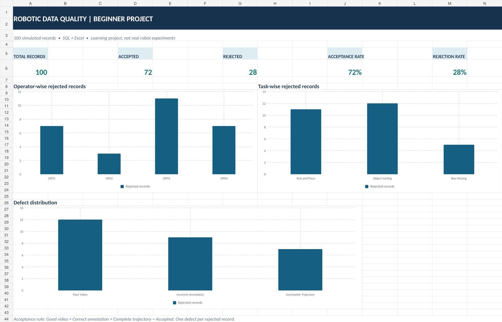

# Robotic Data Quality Analysis using SQL and Excel

## About the Project

This is a beginner-level data analysis project using SQL and Microsoft Excel.

The main aim of this project is to analyze robotic task data, identify quality issues, and understand how data quality can be monitored.

I used a synthetic dataset of 100 robotic task records for this project.

## Tools Used

- SQL (SQLite)
- Microsoft Excel
- CSV Dataset

## Dataset

The dataset contains 100 simulated robotic task records with details such as:

- Record ID
- Operator ID
- Task Type
- Video Quality
- Annotation Status
- Trajectory Status
- Final Acceptance Status

The data is created for learning purposes and does not represent actual robotic experiments.

## What I Did

1. Analyzed the dataset using basic SQL queries.
2. Calculated total accepted and rejected records.
3. Calculated the acceptance and rejection rates.
4. Identified common defects in the dataset.
5. Compared rejected records across operators and tasks.
6. Used Excel to visualize the results through charts.

## Project Results

| Metric | Result |
|---|---|
| Total Records | 100 |
| Accepted Records | 72 |
| Rejected Records | 28 |
| Acceptance Rate | 72% |
| Rejection Rate | 28% |

### Common Defects

- Poor Video Quality: 12 records
- Incorrect Annotations: 9 records
- Incomplete Trajectories: 7 records

## Excel Dashboard

The Excel dashboard shows:

- Total accepted and rejected records
- Acceptance and rejection rates
- Operator-wise defects
- Task-wise rejection analysis
- Common defect categories

## What I Learned

Through this project, I practiced basic SQL queries such as SELECT, WHERE, COUNT, GROUP BY, and ORDER BY.

I also learned how to calculate data quality metrics, identify common errors, and represent findings using Excel charts.

## Future Improvements

- Add more records to the dataset.
- Include additional data quality checks.
- Improve the dashboard with more detailed analysis.

## Note

This project uses synthetic data and was created for learning and practicing SQL, Excel, and basic data quality analysis.
